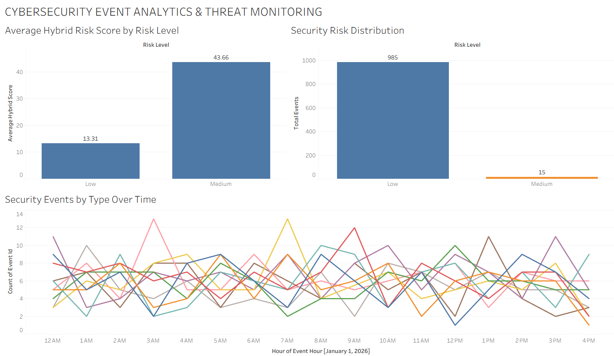

# Cybersecurity Event Analytics

**Author:**
    Satyam

An end-to-end analytics prototype that generates synthetic security events, loads
them into PostgreSQL, calculates hybrid risk scores, detects anomalies, and creates
actionable alerts. Tableau can be used to visualize the resulting data.

> This is a demonstration project using synthetic data. Its anomaly scores and
> alerts indicate unusual patterns, not confirmed attacks or established detection accuracy.

## Features

- Generates 1,000 synthetic cybersecurity events
- Validates and loads events through an ETL pipeline
- Applies rule-based failed-login scoring
- Detects unusual events with Isolation Forest
- Combines rule and anomaly scores into a hybrid risk score
- Stores risks and alerts in PostgreSQL
- Prevents duplicate risk and alert records
- Exports analytical data for Tableau visualization

## How It Works

```text
Synthetic events
      |
      v
CSV generation --> Validation and ETL --> PostgreSQL
                                              |
                           Rule-based risk scoring
                                              |
                         Isolation Forest detection
                                              |
                         Hybrid risk calculation
                                              |
                                  Risk and alert tables
                                              |
                                      Tableau export
```

## Technology

| Category | Tools |
|---|---|
| Language | Python 3 |
| Data processing | Pandas, NumPy |
| Machine learning | Scikit-learn |
| Database | PostgreSQL |
| Database access | SQLAlchemy, psycopg2 |
| Configuration | python-dotenv |
| Visualization | Tableau Public |

## Project Structure

```text
src/
  data_generator/        Synthetic event generation
  etl/                   CSV extraction, transformation, validation, and loading
  database/              PostgreSQL connection
  risk_engine/           Rule, hybrid, and database risk logic
  anomaly_detection/     Isolation Forest model
  alerts/                Alert generation and storage
  analytics/             Complete analytics workflow

database/sql/            PostgreSQL schema and Tableau SQL views
data/raw/                Generated event CSV
docs/                    Project results and dashboard screenshot
reports/                 Project report
tableau/                 Tableau workbook assets
```

## Prerequisites

- Windows 10 or 11
- Python 3.10 or newer
- PostgreSQL 14 or newer
- PostgreSQL command-line tools or pgAdmin
- Tableau Public (optional)

## Installation

Open PowerShell in the repository root.

### 1. Create a virtual environment

```powershell
python -m venv venv
```

### 2. Activate the environment

```powershell
Set-ExecutionPolicy -Scope Process -ExecutionPolicy Bypass
.\venv\Scripts\Activate.ps1
```

If activation is blocked, run commands by calling the virtual environment's Python
executable directly, for example `.\venv\Scripts\python.exe -m pip install -r requirements.txt`.

### 3. Install dependencies

```powershell
python -m pip install --upgrade pip
python -m pip install -r requirements.txt
```

### 4. Configure PostgreSQL

Create the database using `psql` or pgAdmin:

```sql
CREATE DATABASE cybersecurity_db;
```

Apply the schema with `psql`:

```powershell
psql -U postgres -d cybersecurity_db -f "database/sql/schema.sql"
```

If `psql` is not in your `PATH`, use its full installation path. For example:

```powershell
& "D:\software\PostgreSQL\bin\psql.exe" -U postgres -d cybersecurity_db -f "database/sql/schema.sql"
```

Create a `.env` file in the repository root:

```dotenv
DB_USER=postgres
DB_PASSWORD=your_postgres_password
DB_HOST=localhost
DB_PORT=5432
DB_NAME=cybersecurity_db
```

Never commit `.env` or real database credentials. The file is excluded by `.gitignore`.

## Run the Project

Run the stages from the repository root.

### Command-line activation

```powershell
python src/data_generator/generate_data.py
python -m src.etl.etl_pipeline
python -m src.analytics.analysis
```

### Without activating the virtual environment

```powershell
.\venv\Scripts\python.exe src/data_generator/generate_data.py
.\venv\Scripts\python.exe -m src.etl.etl_pipeline
.\venv\Scripts\python.exe -m src.analytics.analysis
```

### Pipeline stages

| Stage | Output |
|---|---|
| Data generator | Writes 1,000 events to `data/raw/security_events_raw.csv` |
| ETL pipeline | Validates and loads events and reference records into PostgreSQL |
| Analytics workflow | Calculates scores, stores risks, and creates alerts |

The database and analytics can be rerun safely. Unique indexes prevent duplicate
risk records and event/alert-type combinations.

## Risk and Alert Rules

### Rule-based score

| Condition | Points |
|---|---:|
| Failed login | 10 |
| Five or more failures in the user's preceding five-minute window | 40 additional |
| New IP address, when enabled | 20 |
| New device, when enabled | 20 |
| Maximum | 100 |

### Hybrid score

```text
hybrid_score = (60% x rule_score) + (40% x normalized_anomaly_score)
```

| Hybrid score | Risk level | Alert severity |
|---|---|---|
| Below 40 | Low | None |
| 40 to below 70 | Medium | Medium |
| 70 to 100 | High | High |

The Isolation Forest model uses authentication and event-frequency features with
5% contamination and a random state of 42.

## Recorded Results

A representative 1,000-event run produced:

| Risk level | Events | Average hybrid score |
|---|---:|---:|
| Low | 991 | Approximately 13 |
| Medium | 9 | Approximately 44 |
| High | 0 | Not applicable |

Exact counts may vary if the generator or scoring configuration changes.

## Tableau Dashboard

The dashboard is designed to show:

1. Security risk distribution
2. Average hybrid risk score by risk level
3. Security events by type over time



The project currently uses CSV snapshots rather than a direct live PostgreSQL
connection. After rerunning the analytics workflow, refresh the CSV source in
Tableau and replace the dashboard data as needed.

## Database Tables

- `users`
- `devices`
- `ip_addresses`
- `security_events`
- `login_history`
- `risk_events`
- `alerts`

The schema defines primary and foreign keys, query indexes, and unique constraints
for duplicate prevention.

## Manual Verification

Check PostgreSQL data with `psql`:

```sql
SELECT risk_level, COUNT(*)
FROM risk_events
GROUP BY risk_level;

SELECT alert_status, severity, COUNT(*)
FROM alerts
GROUP BY alert_status, severity;
```

## Troubleshooting

### `ModuleNotFoundError: No module named 'src'`

Run ETL and analytics commands as modules from the repository root:

```powershell
python -m src.etl.etl_pipeline
python -m src.analytics.analysis
```

### PowerShell script execution is blocked

Use a process-only policy without changing the system-wide setting:

```powershell
Set-ExecutionPolicy -Scope Process -ExecutionPolicy Bypass
.\venv\Scripts\Activate.ps1
```

Alternatively, call `.\venv\Scripts\python.exe` directly.

### PostgreSQL connection fails

- Confirm that the PostgreSQL service is running
- Confirm that `.env` values match the database configuration
- Confirm that the `cybersecurity_db` database exists
- Verify the PostgreSQL username and password

## Documentation

- [Project report](reports/Project_Report.md)
- [Recorded project results](docs/PROJECT_RESULTS.md)
- [Dashboard screenshot](docs/screenshots/tableau_dashboard.png)

## Limitations

- The dataset is synthetic, not real security telemetry
- The model has no verified attack labels
- It processes batches rather than streaming events
- The Tableau connection is currently CSV-based
- New-IP and new-device indicators are not active in the event-level calculation
- These results demonstrate a workflow, not real-world detection performance

## Future Improvements

- Validate against labelled security datasets
- Add precision, recall, F1-score, and false-positive reporting
- Enable real-time event ingestion
- Connect Tableau directly to PostgreSQL
- Activate and validate IP/device indicators
- Generate controlled high-risk test scenarios
- Add analyst investigation and resolution workflows
